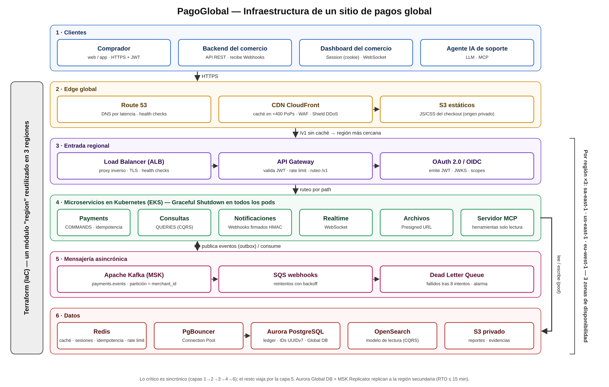
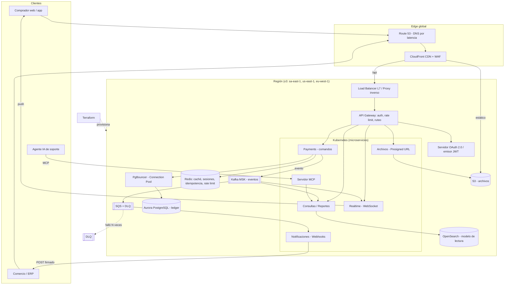
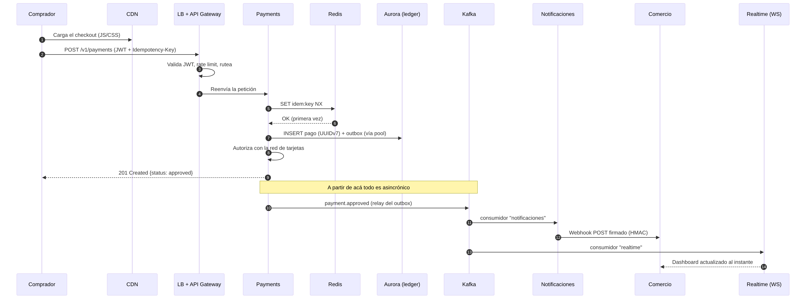
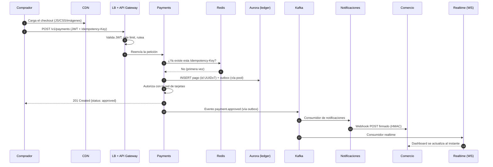

# Trabajo Práctico N.º 2

## Diseño de infraestructura para una plataforma de pagos electrónicos de alcance global

| | |
|---|---|
| **Materia** | Plataformas de Pagos Electrónicos |
| **Tipo de trabajo** | Individual, con exposición oral |
| **Alumno** | Matías Giachello |
| **Caso de estudio** | *PagoGlobal*: una pasarela de pagos (estilo Stripe / Mercado Pago) que opera en América, Europa y Asia |
| **Fecha** | Octubre 2026 |

---

## Índice

1. Introducción y objetivo
2. Caso de estudio: PagoGlobal
3. Requisitos funcionales y no funcionales
4. Vista general de la arquitectura (diagrama)
5. Recorrido de un pago de punta a punta
6. Desarrollo de los conceptos aplicados al caso
   - 6.1 MCP, API y Webhook
   - 6.2 Terraform (Infraestructura como Código)
   - 6.3 CDN
   - 6.4 API Gateway
   - 6.5 Apache Kafka
   - 6.6 Graceful Shutdown
   - 6.7 Session vs JWT
   - 6.8 WebSocket vs Webhook
   - 6.9 API Gateway vs Load Balancer
   - 6.10 CQRS
   - 6.11 OAuth 2.0
   - 6.12 Dead Letter Queue
   - 6.13 Secuencia vs UUID
   - 6.14 Load Balancer y UUID en sistemas distribuidos
   - 6.15 Arquitectura asincrónica con colas
   - 6.16 Presigned URL
   - 6.17 Proxy inverso
   - 6.18 Connection Pool
   - 6.19 Redis
7. Estrategia global: multi‑región, residencia de datos y recuperación ante desastres
8. Seguridad y cumplimiento (PCI DSS)
9. Observabilidad y operación
10. Escenario de estrés: Black Friday / Hot Sale
11. Tabla resumen de decisiones de diseño
12. Estimación de costos de referencia
13. Conclusiones
14. Glosario y bibliografía

Anexos: código Terraform (`terraform/`), ejemplos de código (`codigo/`), diagrama (`diagramas/`), presentación y guion de exposición (`presentacion/`).

---

## 1. Introducción y objetivo

El objetivo de este trabajo es **diseñar la infraestructura de un sitio global** aplicando los conceptos de arquitectura vistos en la materia. Para que el diseño tenga sentido concreto se eligió un dominio exigente y propio de la materia: **una plataforma de pagos electrónicos**. En pagos se combinan los requisitos más duros de la ingeniería de sistemas:

- **Consistencia**: un cobro no puede duplicarse ni perderse.
- **Disponibilidad**: cada minuto caído es dinero que los comercios no cobran.
- **Baja latencia**: el comprador está esperando frente a la pantalla del checkout.
- **Seguridad y regulación**: datos de tarjetas (PCI DSS), datos personales (GDPR, Ley 25.326) y normativa de bancos centrales.
- **Escala global**: usuarios en distintos continentes y picos de tráfico estacionales (Black Friday, Hot Sale, Navidad).

Cada concepto de la consigna (MCP, Terraform, CDN, API Gateway, Kafka, Graceful Shutdown, Session/JWT, WebSocket/Webhook, Load Balancer, CQRS, OAuth, DLQ, Secuencia/UUID, colas, Presigned URL, proxy inverso, Connection Pool y Redis) se presenta con: **qué es**, **qué problema resuelve en PagoGlobal**, **cómo se implementa** y **qué alternativa se descartó y por qué**.

---

## 2. Caso de estudio: PagoGlobal

**PagoGlobal** es una empresa ficticia que ofrece a comercios online un servicio de cobro: el comercio integra un *checkout* (o la API) y PagoGlobal procesa el pago contra las redes de tarjetas (Visa, Mastercard), billeteras y transferencias, y luego le liquida el dinero al comercio.

**Actores:**

| Actor | Qué hace |
|---|---|
| Comprador | Paga desde la web o app móvil del comercio. |
| Comercio | Integra la API, recibe notificaciones (webhooks), consulta reportes. |
| Panel de comercio (dashboard) | Web donde el comercio ve sus ventas en tiempo real. |
| Procesadores / adquirentes | Redes externas que autorizan la tarjeta (Visa, Mastercard, bancos). |
| Agente de IA de soporte | Asistente que responde consultas de comercios usando datos reales vía MCP. |
| Equipo de operaciones | Despliega, monitorea y atiende incidentes. |

**Alcance geográfico:** tres regiones de nube (AWS) para cubrir los mercados principales:

| Región | Ubicación | Mercados atendidos |
|---|---|---|
| `sa-east-1` | San Pablo | Argentina, Brasil, Latinoamérica |
| `us-east-1` | Virginia | Estados Unidos, Canadá, México |
| `eu-west-1` | Irlanda | Unión Europea (con residencia de datos por GDPR) |

---

## 3. Requisitos

### 3.1 Funcionales

1. Crear un **pago** (autorización + captura) con tarjeta, billetera o transferencia.
2. **Reembolsos** totales y parciales.
3. **Notificar** al comercio cada cambio de estado de un pago (aprobado, rechazado, reembolsado, contracargo).
4. **Dashboard en tiempo real** para el comercio con las ventas que van entrando.
5. **Reportes y conciliación**: descarga de archivos de liquidación (CSV/PDF) y subida de documentación de contracargos.
6. **Login** de comercios y de compradores; **“Iniciar sesión con Google”**.
7. **API pública** para que terceros (ERP, e‑commerce, plataformas tipo Tiendanube/Shopify) operen en nombre del comercio.
8. **Asistente de IA** que responde “¿por qué se rechazó el pago X?” consultando datos reales de forma segura.

### 3.2 No funcionales

| Atributo | Objetivo | Justificación |
|---|---|---|
| Disponibilidad | **99,99 %** (≈ 52 minutos de caída por año) | Estándar de la industria de pagos. |
| Latencia de autorización | **p99 < 300 ms** dentro de la plataforma (sin contar al banco emisor) | El comprador está esperando. |
| Throughput normal | 2.000 transacciones por segundo (TPS) | Volumen base estimado. |
| Throughput pico | **20.000 TPS** (Black Friday, ×10) | Picos estacionales. |
| Durabilidad del libro contable (ledger) | **RPO = 0** dentro de la región | No se puede perder un cobro. |
| Recuperación ante caída de región | **RTO ≤ 15 minutos** | Se conmuta a otra región. |
| Idempotencia | Ningún pago se cobra dos veces aunque el cliente reintente | Requisito de negocio crítico. |
| Seguridad | PCI DSS nivel 1, cifrado en tránsito (TLS 1.2+) y en reposo | Regulación de tarjetas. |
| Residencia de datos | Datos de europeos se quedan en la UE | GDPR. |

---

## 4. Vista general de la arquitectura



El diagrama se genera con `diagramas/generar_arquitectura.py` (salida `arquitectura.svg` / `.png`). Una versión con todas las flechas entre componentes está en `diagramas/arquitectura.mmd` (Mermaid) y se reproduce a continuación:



**Lectura del diagrama por capas:**

1. **Edge global** — DNS con ruteo por latencia, CDN con firewall de aplicaciones (WAF).
2. **Entrada regional** — Load Balancer / proxy inverso → API Gateway.
3. **Identidad** — OAuth 2.0 emite JWT; Redis guarda sesiones del dashboard.
4. **Aplicación** — microservicios en Kubernetes con Graceful Shutdown; CQRS separa escrituras (Payments) de lecturas (Consultas).
5. **Datos** — Aurora PostgreSQL (ledger) detrás de un Connection Pool, Redis en memoria, OpenSearch para lecturas.
6. **Asincronía** — Kafka para eventos de dominio, SQS + DLQ para tareas con reintentos (webhooks).
7. **Comunicación con el exterior** — Webhooks a comercios, WebSocket al dashboard, Presigned URLs para archivos, MCP para agentes de IA.
8. **Todo** se crea y versiona con **Terraform**.

---

## 5. Recorrido de un pago de punta a punta

Este es el flujo que se cuenta en la exposición; cada paso indica qué concepto interviene.





1. El navegador baja el checkout desde la **CDN** (milisegundos, sin tocar el backend).
2. El pago entra por el **Load Balancer**, que lo entrega a una instancia sana del **API Gateway**.
3. El Gateway valida el **JWT** emitido por **OAuth 2.0**, aplica **rate limiting** (contadores en **Redis**) y rutea al servicio Payments.
4. Payments consulta en **Redis** la `Idempotency-Key`: si el cliente reintentó por un timeout, se devuelve la misma respuesta y **no se cobra dos veces**.
5. Se escribe el pago en **Aurora PostgreSQL** usando una conexión del **Connection Pool**, con un identificador **UUIDv7** generado en la propia instancia.
6. En la misma transacción se escribe el evento en una tabla *outbox*; un proceso lo publica en **Kafka** (patrón *Transactional Outbox*, evita que el pago se guarde y el evento se pierda).
7. Al comprador se le responde **en el momento** (la parte sincrónica termina acá).
8. De forma **asincrónica**: el servicio de Notificaciones manda el **Webhook** al comercio (con reintentos y **DLQ**), el servicio de Consultas actualiza el modelo de lectura (**CQRS**) y el servicio Realtime empuja el pago al dashboard por **WebSocket**.
9. Si en ese momento se está desplegando una versión nueva, los pods viejos hacen **Graceful Shutdown**: terminan el pago en curso antes de apagarse.

---

## 6. Desarrollo de los conceptos aplicados al caso

### 6.1 MCP, API y Webhook

**Definiciones.**

- **API**: contrato de comunicación de tipo **solicitud‑respuesta**. El cliente pregunta y el servidor responde. *Ejemplo:* `GET /v1/payments/pay_01J...` devuelve el estado del pago.
- **Webhook** (“API inversa”): el **servidor avisa** al cliente mediante un `HTTP POST` cuando ocurre un evento, evitando que el cliente tenga que preguntar continuamente (*polling*). *Ejemplo:* PagoGlobal hace `POST https://tienda.com/webhooks/pagoglobal` con el evento `payment.approved`.
- **MCP (Model Context Protocol)**: protocolo abierto, propuesto por Anthropic en 2024, que estandariza cómo un **modelo de lenguaje (LLM)** se conecta a herramientas y fuentes de datos. Un *servidor MCP* expone **herramientas** (*tools*), **recursos** y *prompts* que el modelo puede descubrir y usar con un formato común (JSON‑RPC).

**Aplicación en PagoGlobal.**

| Mecanismo | Quién inicia | Uso en PagoGlobal |
|---|---|---|
| API REST | Cliente (comercio) | Crear pagos, reembolsos, consultar estados. |
| Webhook | PagoGlobal | Avisar al comercio que un pago cambió de estado. |
| MCP | Agente de IA | El asistente de soporte usa la herramienta `buscar_pago(id)` y `motivo_rechazo(id)` para responder “¿por qué se rechazó este pago?”. |

**Seguridad de los webhooks** (clave en pagos):

1. Cada envío lleva la cabecera `PagoGlobal-Signature: t=<timestamp>,v1=<HMAC-SHA256>` calculada con un secreto por comercio. El comercio verifica la firma y descarta mensajes con timestamp de más de 5 minutos (evita *replay attacks*).
2. Los envíos son **al menos una vez** (*at‑least‑once*): el comercio debe ser **idempotente** usando el `event_id`.
3. Reintentos con *backoff* exponencial (1 min, 5 min, 30 min, 2 h, 6 h…) y, tras agotarlos, el evento va a la **DLQ** (ver 6.12).

**Seguridad del servidor MCP:** el servidor MCP **solo expone herramientas de lectura**, autenticadas con OAuth (el agente actúa con un token de alcance `payments:read` del comercio que pregunta). Nunca se le da al modelo una herramienta que mueva dinero.

Código de ejemplo: `codigo/webhook_firma.py` y `codigo/mcp_server.py`.

---

### 6.2 Terraform (Infraestructura como Código)

**Qué es.** Herramienta de **IaC** de HashiCorp. La infraestructura se describe en archivos `.tf` (lenguaje HCL) de forma **declarativa**: se dice *qué* se quiere (3 subredes, un clúster de Kafka, una base de datos) y Terraform calcula *cómo* llegar desde el estado actual (`terraform plan`) y lo aplica (`terraform apply`). Guarda un **estado** (*state*) que representa lo que ya existe.

**Por qué es fundamental para un sitio global.** PagoGlobal tiene la **misma infraestructura repetida en tres regiones**. Sin IaC, crear a mano la región de Europa llevaría días y quedaría distinta a las otras (*configuration drift*). Con Terraform:

- Se escribe un **módulo `region`** una sola vez y se instancia tres veces cambiando parámetros.
- Cada cambio pasa por *pull request*, revisión y `terraform plan` en el pipeline de CI (auditoría exigida por PCI DSS).
- Recuperación ante desastres: se puede reconstruir una región entera desde código.
- El *state* se guarda en un bucket S3 cifrado con bloqueo para que dos personas no apliquen cambios a la vez.

```hcl
module "region_sa" {
  source      = "./modules/region"
  providers   = { aws = aws.sa }
  region_name = "sa-east-1"
  vpc_cidr    = "10.10.0.0/16"
  eks_min_nodes = 6
  eks_max_nodes = 60   # escala para Hot Sale
}
```

El código completo está en `terraform/` (VPC, EKS, Aurora, ElastiCache Redis, MSK Kafka, SQS + DLQ, S3, ALB, API Gateway, CloudFront y Route 53).

**Alternativas:** CloudFormation (solo AWS), Pulumi (IaC con lenguajes de programación). Se eligió Terraform por ser **multi‑nube** y el estándar de la industria.

---

### 6.3 CDN (Content Delivery Network)

**Qué es.** Red de servidores caché distribuidos en el mundo (*edge locations* o PoPs) que guardan copias del contenido estático cerca del usuario.

**Aplicación.** El *checkout* de PagoGlobal (JavaScript, CSS, fuentes, logos de tarjetas) se sirve desde **CloudFront**:

- Un comprador en Tokio o en Córdoba descarga el JS desde el PoP más cercano: **~20 ms** en lugar de ~250 ms al origen.
- El origen (S3) recibe una fracción mínima del tráfico; en un Black Friday esto es lo que evita que se caiga.
- La CDN también actúa como **escudo**: integra **WAF** (bloqueo de inyecciones SQL, bots, países) y absorbe ataques **DDoS** (AWS Shield).
- Los archivos se publican con *hash* en el nombre (`checkout.3f9a1c.js`) y caché de 1 año; al desplegar una versión nueva cambia el nombre, así no hace falta invalidar caché.

**Qué NO va a la CDN:** las respuestas de la API de pagos (son dinámicas y privadas). La CDN solo las **reenvía** al origen correspondiente sin cachearlas (`Cache-Control: no-store`).

---

### 6.4 API Gateway

**Qué es.** Punto de entrada único a los microservicios. Se ocupa de las tareas **transversales** para que cada servicio no tenga que reimplementarlas.

**Responsabilidades en PagoGlobal:**

| Función | Ejemplo concreto |
|---|---|
| Ruteo | `/v1/payments/*` → Payments; `/v1/reports/*` → Consultas; `/v1/files/*` → Archivos. |
| Autenticación | Valida firma y expiración del JWT antes de que la petición llegue al servicio. |
| Rate limiting | Cada comercio tiene un cupo (ej. 1.000 req/s); el excedente recibe `429 Too Many Requests`. Contadores en Redis. |
| Versionado | `/v1` y `/v2` conviven y se rutean a versiones distintas del servicio. |
| Transformación | Agrega `X-Request-Id` para trazabilidad, quita cabeceras internas de la respuesta. |
| Observabilidad | Métricas de latencia y errores por ruta y por comercio. |

**Implementación:** Amazon API Gateway (HTTP API) o, dentro del clúster, Kong / Envoy Gateway. En el código Terraform se usa API Gateway HTTP API con *authorizer* JWT.

---

### 6.5 Apache Kafka

**Qué es.** Plataforma distribuida de *streaming* de eventos. Los productores escriben eventos en **tópicos**; cada tópico está dividido en **particiones** (logs ordenados, persistentes y replicados). Los consumidores se organizan en **grupos de consumo** y cada grupo lee el flujo completo de manera independiente. A diferencia de una cola clásica, **los mensajes no se borran al leerse**: se retienen (ej. 7 días) y se pueden “re‑leer” (*replay*).

**Aplicación.** Tópico `payments.events`, **clave de partición = `merchant_id`**, para garantizar que **todos los eventos de un comercio se procesen en orden** (aprobado antes que reembolsado).

```
payments.events (48 particiones, replicación 3, min.insync.replicas 2)
  ├─ grupo "notificaciones"  → envía webhooks
  ├─ grupo "consultas"       → actualiza OpenSearch (CQRS)
  ├─ grupo "realtime"        → empuja al dashboard por WebSocket
  ├─ grupo "antifraude"      → recalcula score de riesgo
  └─ grupo "contabilidad"    → genera asientos y liquidaciones
```

Agregar un nuevo consumidor (por ejemplo, un servicio de puntos de fidelidad) **no requiere tocar Payments**: solo se suscribe al tópico. Eso es **desacoplamiento**.

**Garantías configuradas:** productor con `acks=all` e `enable.idempotence=true` (no duplica en reintentos), réplicas en 3 zonas de disponibilidad. Implementación administrada: **Amazon MSK**.

---

### 6.6 Graceful Shutdown (apagado elegante)

**Qué es.** Cuando un proceso recibe `SIGTERM` (por un despliegue, un *autoscaling* que reduce nodos o un mantenimiento), en lugar de morir en seco:

1. **Deja de aceptar** peticiones nuevas (el *readiness probe* pasa a fallar y el Load Balancer lo saca de rotación).
2. **Termina** las peticiones en curso.
3. **Cierra** recursos: confirma *offsets* de Kafka, devuelve conexiones al pool, cierra WebSockets con código 1001 (“going away”) para que el cliente reconecte a otra instancia.
4. Sale con código 0.

**Por qué es crítico en pagos.** Si un pod muere justo después de que la red de tarjetas aprobó el cobro pero antes de guardarlo en la base, el comprador queda **cobrado sin registro**. PagoGlobal despliega varias veces por día; sin apagado elegante, cada despliegue generaría errores.

**Configuración en Kubernetes:**

```yaml
spec:
  terminationGracePeriodSeconds: 45
  containers:
    - name: payments
      lifecycle:
        preStop:
          exec: { command: ["sleep", "10"] }   # da tiempo a que el LB lo saque de rotación
      readinessProbe:
        httpGet: { path: /ready, port: 8080 }
```

Código de ejemplo: `codigo/graceful_shutdown.py`.

---

### 6.7 Session vs JWT

| | **Session (stateful)** | **JWT (stateless)** |
|---|---|---|
| Qué recibe el cliente | Cookie con un ID aleatorio | Token firmado con *claims* (usuario, rol, expiración) |
| Dónde está el estado | En el servidor (Redis) | Dentro del token |
| Validación | Consulta a Redis en cada request | Verificación criptográfica de la firma, sin consultar nada |
| Revocación | **Inmediata** (se borra la clave en Redis) | Difícil: el token es válido hasta que expira (requiere lista negra) |
| Escala multi‑región | Requiere replicar el almacén de sesiones | Excelente: cualquier región valida con la clave pública |
| Riesgo típico | CSRF (se mitiga con `SameSite`) | Robo del token; tokens largos sin revocación |

**Decisión de PagoGlobal: usar los dos, cada uno donde conviene.**

- **API pública y servicio‑a‑servicio → JWT** de corta duración (**10 minutos**), firmados con RS256/ES256. El Gateway de cualquier región los valida con la clave pública (endpoint JWKS) sin ir a una base central. Se renuevan con *refresh token*.
- **Dashboard web del comercio → Session** en Redis, cookie `HttpOnly; Secure; SameSite=Strict`. Motivo: si un comercio reporta que le robaron la cuenta, **hay que poder cerrar la sesión en el acto**, y con JWT no se puede sin infraestructura adicional.

Código de ejemplo: `codigo/session_vs_jwt.py`.

---

### 6.8 WebSocket vs Webhook

| | **WebSocket** | **Webhook** |
|---|---|---|
| Conexión | Persistente, bidireccional (*full‑duplex*) sobre una conexión TCP | Una petición HTTP POST por evento, luego se cierra |
| Dirección | Cliente ↔ servidor | Servidor → servidor de un tercero |
| Destinatario | Un navegador/app conectado ahora | Un sistema backend que puede estar o no “escuchando” |
| Uso típico | Chat, cotizaciones, dashboards en vivo | Integraciones entre sistemas |
| Si el receptor está caído | El mensaje se pierde salvo que se reenvíe al reconectar | Se reintenta (y DLQ) |

**En PagoGlobal:**

- **WebSocket**: el **dashboard** del comercio abierto en el navegador muestra cada venta en el momento (“+ $12.500 — Visa ****4242 — aprobado”). Conexión `wss://realtime.pagoglobal.com`, autenticada con el JWT en el *handshake*.
- **Webhook**: el **backend** del comercio (su sistema de stock o su ERP) recibe el evento para marcar el pedido como pagado y despachar la mercadería.

Los dos se alimentan del **mismo evento en Kafka**: dos consumidores distintos, dos canales de salida.

**Escalado de WebSockets:** como cada conexión vive en un pod, si el evento llega a un pod que no tiene a ese comercio conectado se usa **Redis Pub/Sub** como bus entre pods. El Load Balancer necesita soporte de *upgrade* HTTP → WS (el ALB lo tiene) y *timeouts* largos.

Código de ejemplo: `codigo/websocket_dashboard.py`.

---

### 6.9 API Gateway vs Load Balancer

| | **Load Balancer** | **API Gateway** |
|---|---|---|
| Capa | L4 (TCP) o L7 (HTTP básico) | L7 con lógica de aplicación |
| Objetivo principal | Repartir carga entre **instancias iguales** y sacar las que fallan (*health checks*) | Rutear a **servicios distintos** y aplicar políticas |
| Entiende de | IPs, puertos, rutas simples, salud de instancias | Rutas de API, JWT, cuotas por cliente, versiones, transformaciones |
| Ejemplo | AWS NLB / ALB, HAProxy | AWS API Gateway, Kong, Apigee |

**No compiten: se combinan.** En PagoGlobal la cadena es:

```
Cliente → CloudFront → ALB (reparte entre 3+ réplicas del Gateway en 3 AZ)
        → API Gateway (decide a qué microservicio y aplica políticas)
        → Service de Kubernetes (balanceo interno entre pods del microservicio)
```

Es decir, **hay balanceo en varias capas**: el ALB balancea al Gateway, y Kubernetes balancea a los pods de cada servicio.

---

### 6.10 CQRS (Command Query Responsibility Segregation)

**Qué es.** Separar el modelo de **escritura** (comandos que cambian estado) del modelo de **lectura** (consultas), cada uno con su base optimizada.

**El problema en PagoGlobal.** La base del *ledger* (Aurora PostgreSQL) está normalizada y optimizada para escrituras transaccionales con integridad (doble partida, restricciones, *locks*). Pero el dashboard pide cosas como “ventas de los últimos 90 días agrupadas por medio de pago con búsqueda por texto del comprador”. Esa consulta en la base transaccional, en hora pico, **frena a los pagos**.

**Solución:**

```
Comandos (POST /payments, /refunds) ─► Payments ─► Aurora PostgreSQL (fuente de verdad)
                                              │
                                              └─► evento en Kafka
                                                        │
Consultas (GET /reports, búsqueda) ◄── Consultas ◄── OpenSearch (vista desnormalizada)
```

- El servicio de Consultas consume `payments.events` y mantiene documentos ya armados para mostrar.
- **Consecuencia aceptada: consistencia eventual.** Un pago puede tardar ~1 segundo en aparecer en reportes. Para el *estado puntual* de un pago (`GET /payments/{id}`), que sí debe ser exacto, se lee del lado de comandos.
- Ventaja: cada lado **escala por separado** (en Black Friday crecen las escrituras; a fin de mes, cuando los comercios bajan reportes, crecen las lecturas).

Código de ejemplo: `codigo/cqrs_proyeccion.py`.

---

### 6.11 OAuth 2.0

**Qué es.** Protocolo de **autorización delegada**: permite que una aplicación de terceros acceda a recursos de un usuario **con permisos limitados (scopes)** y **sin conocer su contraseña**. Roles: *Resource Owner* (comercio), *Client* (la app de terceros), *Authorization Server* (emite tokens), *Resource Server* (la API de PagoGlobal). Para el login con identidad se usa **OpenID Connect**, una capa sobre OAuth 2.0.

**Tres usos en PagoGlobal:**

| Flujo OAuth | Caso |
|---|---|
| **Authorization Code + PKCE** | Una plataforma de e‑commerce (ej. una tienda online) pide permiso al comercio para “crear cobros y leer pagos en su nombre”. El comercio ve una pantalla de consentimiento con los scopes `payments:write payments:read`. La plataforma nunca ve la contraseña del comercio y el comercio puede revocar el acceso. |
| **Client Credentials** | Comunicación servidor‑a‑servidor: el ERP del comercio obtiene un token con su `client_id`/`client_secret`. También entre microservicios internos. |
| **OpenID Connect** | “Iniciar sesión con Google” en el dashboard. |

El Authorization Server emite **JWT** firmados (ver 6.7) y publica su clave pública en `/.well-known/jwks.json` para que los Gateways de las tres regiones validen localmente. Implementación: Keycloak autogestionado o Amazon Cognito / Auth0.

---

### 6.12 Dead Letter Queue (DLQ)

**Qué es.** Cola secundaria donde se envían los mensajes que **fallaron repetidamente**, para no perderlos y para que no bloqueen ni reintenten infinitamente en la cola principal.

**Aplicación: webhooks a comercios.**

```
Kafka payments.events
      │
      ▼
SQS "webhooks"  ──(worker intenta POST al comercio)──► éxito → se borra
      │ falla (timeout, 500, DNS)
      │ reintentos con backoff hasta maxReceiveCount = 8 (~24 h)
      ▼
SQS "webhooks-dlq"  (retención 14 días)
      │
      ├─► alarma en CloudWatch si hay mensajes
      ├─► el comercio ve "Webhooks fallidos" en el dashboard y puede reenviarlos
      └─► operaciones puede re‑encolarlos (redrive) cuando el comercio arregla su servidor
```

**Distinguir errores:** un error **transitorio** (timeout, 503) se reintenta; un error **permanente** (el mensaje está mal formado, 4xx del comercio por URL inexistente) va **directo** a la DLQ sin gastar reintentos. Un mensaje “veneno” que siempre rompe el consumidor nunca debe frenar a los demás.

En Kafka, que no tiene DLQ nativa, el consumidor publica el mensaje fallido en un tópico `payments.events.dlq` con metadatos del error.

Código de ejemplo: `codigo/consumidor_dlq.py`.

---

### 6.13 Secuencia vs UUID

| | **Secuencia autoincremental** | **UUID v4 (aleatorio)** | **UUID v7 (ordenado por tiempo)** |
|---|---|---|---|
| Ejemplo | `1045892` | `1b9d6bcd-bbfd-4b2d-9b5d-ab8dfbbd1b9d` | `0192c7a2-6b3e-7c1d-9f2a-...` |
| Tamaño | 8 bytes | 16 bytes | 16 bytes |
| ¿Quién lo genera? | La base de datos (punto central) | Cualquier instancia, sin coordinar | Cualquier instancia, sin coordinar |
| ¿Adivinable? | **Sí** (enumeración: `/payments/1045893`) | No | No (parte aleatoria de 74 bits) |
| ¿Revela volumen de negocio? | Sí (la competencia ve cuántos pagos hacés) | No | No |
| Rendimiento en índice B‑tree | Excelente (inserción al final) | **Malo** (inserción aleatoria, fragmenta páginas) | Muy bueno (crece casi en orden) |
| Multi‑región | Conflictos o rangos por región | Sin conflictos | Sin conflictos |

**Decisión de PagoGlobal: UUIDv7** (RFC 9562, 2024) como identificador de pagos, expuesto con prefijo legible: `pay_0192c7a26b3e7c1d...`.

- Es **imposible de enumerar** (vulnerabilidad IDOR: un atacante no puede recorrer pagos de otros comercios cambiando el número).
- Se genera **en la aplicación, en cualquier región**, sin ir a la base: necesario para escribir el outbox y el evento con el ID antes del *commit*.
- Al estar ordenado por tiempo, **no degrada el índice** como UUIDv4.

Se mantiene una **secuencia** solo en tablas internas que nunca salen a la API (por ejemplo, el número correlativo de factura fiscal, que por normativa debe ser consecutivo).

Código de ejemplo: `codigo/uuid_vs_secuencia.py`.

---

### 6.14 Load Balancer y UUID en sistemas distribuidos

Comparar un Load Balancer con un UUID es comparar infraestructura de red con un tipo de dato, pero en un sistema distribuido los dos conceptos **se cruzan**:

1. **El LB hace que cualquier instancia pueda atender cualquier petición.** Si el ID se genera con una secuencia centralizada, todas las instancias dependen de un único punto (la base) para crear un pago, y ese punto se vuelve cuello de botella. Con UUID, **cada instancia genera IDs por su cuenta**, y el LB puede repartir libremente.
2. **Idempotencia detrás de un LB.** El cliente envía un `Idempotency-Key` (un UUID que genera él). Si su primera petición llegó a la instancia A y el reintento llega a la instancia B, ambas consultan la misma clave en Redis: el pago no se duplica aunque el LB haya mandado cada intento a un servidor distinto.
3. **Trazabilidad.** El Gateway asigna un `X-Request-Id` (UUID) a cada petición; viaja por todos los servicios y logs y permite seguir una petición que pasó por el LB, el Gateway, Payments y Kafka.
4. **Afinidad por ID (consistent hashing).** Cuando sí interesa que todo lo de un mismo cliente vaya al mismo lugar (por ejemplo, la partición de Kafka por `merchant_id`, o el *sharding* de la base), se aplica un **hash del identificador** en lugar del balanceo *round‑robin*.

**Conclusión:** un LB *stateless* + IDs generados de forma descentralizada (UUID) es la combinación que permite **escalar horizontalmente** sin coordinación.

---

### 6.15 Arquitectura asincrónica con colas

**Qué es.** Los componentes se comunican dejando mensajes en un intermediario en lugar de llamarse por HTTP y esperar la respuesta.

**Regla de diseño de PagoGlobal:** *“Lo que el comprador necesita para ver ‘Pago aprobado’ es sincrónico; todo lo demás es asincrónico.”*

| Sincrónico (en la petición) | Asincrónico (después, por colas/eventos) |
|---|---|
| Validar datos y antifraude básico | Enviar webhook al comercio |
| Autorizar contra la red de tarjetas | Enviar email/recibo al comprador |
| Guardar el pago en el ledger | Actualizar reportes (CQRS) |
| Responder al cliente | Calcular comisiones y liquidaciones |
| | Notificar al dashboard en tiempo real |

**Beneficios:**

- **Latencia**: el comprador no espera al email ni al webhook.
- **Tolerancia a fallos**: si el servicio de emails se cae, los mensajes esperan en la cola y se procesan al volver; el cobro no se ve afectado.
- **Amortiguación de picos (*load leveling*)**: en Black Friday entran 20.000 pagos/s, pero los workers de emails procesan a su ritmo y la cola absorbe la diferencia.

**Kafka vs cola clásica (SQS/RabbitMQ):** Kafka se usa para **eventos de dominio** que leen muchos consumidores y que se quieren poder re‑procesar; SQS para **tareas** puntuales con reintentos por mensaje y DLQ (cada webhook a cada comercio).

**Patrón Outbox:** para no tener el problema de “guardé el pago pero falló la publicación del evento”, el evento se escribe en una tabla `outbox` **en la misma transacción** que el pago, y un proceso separado (o CDC con Debezium) lo publica en Kafka.

---

### 6.16 Presigned URL (URL prefirmada)

**Qué es.** URL de un objeto en almacenamiento (S3) que incluye una **firma criptográfica con vencimiento**. Quien la tenga puede hacer **una acción concreta** (descargar o subir **ese** archivo) **durante un tiempo limitado**, sin credenciales propias y sin que el bucket sea público.

**Usos en PagoGlobal:**

1. **Descarga de reportes de liquidación**: el comercio pide su reporte mensual (puede pesar cientos de MB). El backend verifica permisos y responde con una URL de S3 válida por **5 minutos**. El archivo baja **directo de S3**, sin pasar por los servidores de aplicación.
2. **Subida de evidencia de contracargos**: el comercio debe subir comprobantes de entrega (PDF, fotos). El backend genera una URL `PUT` prefirmada con tamaño máximo y tipo de contenido restringidos; el navegador sube directo a S3. Un evento de S3 dispara el antivirus y el registro del documento.

**Ventajas:** no se exponen credenciales, el bucket sigue privado y cifrado, el ancho de banda pesado no consume CPU de los microservicios, y cada URL queda auditada en CloudTrail.

Código de ejemplo: `codigo/presigned_url.py`.

---

### 6.17 Proxy inverso

**Qué es.** Servidor que se ubica **delante** de los servidores de backend, recibe las peticiones de los clientes y las reenvía internamente. El cliente no sabe qué servidor real lo atendió. (El *proxy directo*, en cambio, está del lado del cliente).

**Funciones en PagoGlobal:**

- **Terminación TLS**: el certificado HTTPS vive en el proxy/LB; internamente se usa mTLS entre servicios.
- **Ocultar la topología**: los pods y bases nunca tienen IP pública; todo está en subredes privadas.
- **Compresión, cabeceras de seguridad** (`Strict-Transport-Security`, `X-Content-Type-Options`), límites de tamaño de body.
- **Balanceo** y *health checks*.
- **Caché** de respuestas públicas (por ejemplo, la lista de medios de pago disponibles por país).

**Dónde aparece:** la CDN es un proxy inverso global; el ALB es un proxy inverso regional; el *Ingress Controller* de Kubernetes (NGINX/Envoy) es un proxy inverso dentro del clúster; y **PgBouncer** es un proxy inverso para la base de datos. *El API Gateway es un proxy inverso especializado en APIs.*

---

### 6.18 Connection Pool (pool de conexiones)

**Qué es.** Conjunto de conexiones abiertas y reutilizables hacia la base (o Redis, o un servicio externo). Abrir una conexión a PostgreSQL implica *handshake* TCP + TLS + autenticación + creación de un proceso en el servidor (**decenas de milisegundos y varios MB de RAM**). El pool las abre una vez y las **presta** a cada petición.

**El problema concreto en PagoGlobal.** En Black Friday hay **200 pods** de Payments. Si cada uno abre 20 conexiones, son **4.000 conexiones**; PostgreSQL empieza a degradarse mucho antes (cada conexión es un proceso del sistema operativo).

**Solución en dos niveles:**

```
200 pods × pool local de 10 conexiones (en la app)
        │  = 2.000 conexiones "lógicas"
        ▼
PgBouncer (modo transaction pooling, 3 réplicas)
        │  multiplexa
        ▼
Aurora PostgreSQL: ~300 conexiones reales
```

**Parámetros que se ajustan:** tamaño mínimo/máximo, *timeout* para obtener una conexión (si se agota, fallar rápido con `503` en lugar de colgar la petición), tiempo máximo de vida de cada conexión (para rotar tras una conmutación de base) y validación de conexión antes de usarla. En el **Graceful Shutdown** el pool se cierra al final, después de terminar las peticiones en curso.

Lo mismo vale para la conexión con **Redis** y para las conexiones HTTP salientes a las redes de tarjetas (*keep‑alive*).

Código de ejemplo: `codigo/cache_aside_pool.py`.

---

### 6.19 Redis

**Qué es.** Base de datos **en memoria** clave‑valor, con estructuras de datos (strings, hashes, listas, sets, sorted sets, streams), tiempos de vida (TTL) y latencias de **menos de un milisegundo**. El núcleo de ejecución de comandos es *single‑threaded*, lo que hace cada comando **atómico**.

**Cinco usos en PagoGlobal:**

| Uso | Estructura / comando | Detalle |
|---|---|---|
| **Idempotencia** | `SET idem:{key} {respuesta} NX EX 86400` | `NX` = solo si no existe: la primera petición “gana”, los reintentos leen la respuesta guardada. |
| **Rate limiting** | `INCR` + `EXPIRE` por ventana | `rl:{merchant}:{segundo}`; si supera el cupo → `429`. |
| **Sesiones del dashboard** | Hash con TTL | `session:{id}` con usuario, rol y expiración; revocación con `DEL`. |
| **Caché (cache‑aside)** | `GET` / `SETEX` | Configuración del comercio, tasas de cambio, reglas antifraude. |
| **Pub/Sub para WebSockets** | `PUBLISH` / `SUBSCRIBE` | Para avisar a todos los pods de Realtime. |

**Despliegue:** Amazon ElastiCache (Redis/Valkey) en **modo clúster**, réplicas en 3 zonas y conmutación automática. **Redis no es la fuente de verdad**: si se pierde, el sistema se degrada (más latencia) pero no pierde pagos. Si Redis no responde, el código **cae a la base** (degradación elegante).

---

## 7. Estrategia global: multi‑región, residencia de datos y recuperación ante desastres

### 7.1 Ruteo global

- **Route 53 con ruteo por latencia**: `api.pagoglobal.com` resuelve a la región más cercana al cliente que esté sana (*health checks* cada 10 s).
- **CloudFront** delante de todo para TLS cercano al usuario y WAF.

### 7.2 Modelo de celdas por región de origen (*home region*)

El gran desafío de pagos global es que **el ledger debe ser consistente**: no puede haber dos regiones escribiendo el saldo del mismo comercio a la vez. Se adopta este modelo:

- Cada **comercio tiene una región de origen** (por su país). Sus pagos se **escriben** en esa región. Un comprador europeo pagándole a un comercio argentino entra por la región más cercana, y el Gateway reenvía el comando a `sa-east-1` por la red privada de AWS.
- **Lecturas** (catálogo de medios de pago, configuración, reportes) se sirven desde cualquier región con réplicas de lectura.
- **Residencia de datos**: los comercios de la UE tienen su región de origen en `eu-west-1` y sus datos personales **no se replican fuera** (GDPR).

### 7.3 Alta disponibilidad y desastres

| Nivel de falla | Mecanismo | Impacto |
|---|---|---|
| Cae un pod | Kubernetes lo reemplaza; LB deja de enviarle tráfico | Nulo |
| Cae un nodo | Pods replanificados en otros nodos (≥ 3 réplicas por servicio) | Nulo |
| Cae una zona de disponibilidad (AZ) | Todo está desplegado en 3 AZ; Aurora conmuta su instancia de escritura en ~30 s | Segundos |
| **Cae una región entera** | **Aurora Global Database** replica a una región secundaria con < 1 s de retraso; se promueve la secundaria y Route 53 desvía el tráfico | RTO ≤ 15 min, RPO ≈ 1 s |

Para lograr **RPO = 0** en pagos ya confirmados ante la caída de una región, los eventos confirmados también se replican a la región secundaria con **MSK Replicator**, y la conciliación con las redes de tarjetas (que tienen su propio registro) permite reconstruir cualquier transacción del último segundo.

**Se prueba**: simulacros trimestrales de caída de región (*game days*) — un plan de DR no probado no existe.

---

## 8. Seguridad y cumplimiento (PCI DSS)

1. **Reducción de alcance PCI**: los números de tarjeta (PAN) se **tokenizan** apenas entran, en un servicio aislado (*vault*) en una VPC separada. El resto de la plataforma solo ve `tok_...`. Así la mayoría de los servicios quedan fuera del alcance de auditoría.
2. **Cifrado**: TLS 1.2+ externo, **mTLS** entre servicios (service mesh), cifrado en reposo con claves KMS por región; las claves de tarjetas en **HSM** (CloudHSM).
3. **Red**: subredes privadas para app y datos; solo el LB es público; *security groups* mínimos; WAF y AWS Shield en el borde.
4. **Identidad**: OAuth 2.0 + JWT de vida corta; MFA obligatorio en el dashboard; principio de mínimo privilegio en IAM.
5. **Secretos**: AWS Secrets Manager con rotación automática; nunca en el código ni en variables de Terraform en texto plano.
6. **Auditoría**: CloudTrail, logs inmutables (S3 Object Lock), todo cambio de infra vía Terraform + pull request.
7. **Antifraude**: scoring en tiempo real + 3‑D Secure 2 para pagos riesgosos.

---

## 9. Observabilidad y operación

- **Métricas** (Prometheus/CloudWatch): tasa de aprobación, latencia p50/p99 por ruta, errores 5xx, profundidad de colas, *lag* de consumidores de Kafka, mensajes en DLQ.
- **Logs estructurados** (JSON) con `request_id` y `payment_id`.
- **Trazas distribuidas** (OpenTelemetry): una traza muestra CDN → Gateway → Payments → DB → Kafka → Webhook.
- **SLO y alertas**: “99,95 % de autorizaciones en < 300 ms medido en 30 días”; alertas por *error budget*.
- **Despliegues**: GitOps (Argo CD), *canary* de 5 % → 25 % → 100 % con rollback automático si sube la tasa de error. Graceful Shutdown garantiza que el recambio de pods no genere errores.

---

## 10. Escenario de estrés: Black Friday / Hot Sale

Así responde cada pieza ante un pico de ×10 (de 2.000 a 20.000 TPS):

| Momento | Qué pasa | Qué lo resuelve |
|---|---|---|
| T‑7 días | Se pre‑escala la infraestructura (más nodos mínimos, más particiones) | **Terraform** (`eks_min_nodes = 30`) |
| Avalancha de visitas al checkout | 95 % de los bytes son estáticos | **CDN** |
| Bots y abuso | Picos anómalos de un mismo origen | **WAF + rate limiting** en el **API Gateway** con **Redis** |
| Reintentos del cliente por lentitud | Riesgo de cobro doble | **Idempotency‑Key** en **Redis** |
| Muchas escrituras simultáneas | Riesgo de agotar conexiones de la base | **Connection Pool** + PgBouncer |
| Comercios refrescando el dashboard | Lecturas pesadas | **CQRS** (OpenSearch) + **WebSocket** en lugar de *polling* |
| Emails, webhooks, comisiones | No pueden frenar el cobro | **Colas / Kafka** absorben el pico |
| El servidor de un comercio se cae por su propio tráfico | Webhooks fallan | Reintentos + **DLQ** y reenvío posterior |
| Autoscaling sube y baja pods constantemente | Riesgo de cortar pagos en curso | **Graceful Shutdown** |
| Los comercios descargan reportes del día | Archivos pesados | **Presigned URLs** directo a S3 |

---

## 11. Tabla resumen de decisiones de diseño

| # | Concepto | Decisión en PagoGlobal | Alternativa descartada y motivo |
|---|---|---|---|
| 1 | API / Webhook / MCP | REST + webhooks firmados HMAC + servidor MCP de solo lectura | *Polling* del comercio: carga inútil y latencia |
| 2 | Terraform | Módulo `region` reutilizado en 3 regiones, state en S3 | Consola manual: no reproducible ni auditable |
| 3 | CDN | CloudFront + WAF + Shield para estático | Servir estático desde la app: caro y lento |
| 4 | API Gateway | Ruteo, JWT, rate limit, versionado | Cada servicio con su propia auth: duplicación y errores |
| 5 | Kafka | `payments.events` particionado por `merchant_id` | Llamadas HTTP en cadena: acoplamiento |
| 6 | Graceful Shutdown | `SIGTERM` → readiness off → drenar → cerrar recursos | Kill abrupto: cobros sin registrar |
| 7 | Session vs JWT | JWT corto para API; Session en Redis para dashboard | Solo JWT: no se puede revocar al instante |
| 8 | WebSocket vs Webhook | WS para dashboard en vivo; Webhook para backends | *Polling* cada 2 s: miles de peticiones inútiles |
| 9 | API GW vs LB | ALB delante del Gateway; los dos | Elegir uno solo: pierde HA o pierde políticas |
| 10 | CQRS | Aurora (escritura) + OpenSearch (lectura) | Una sola base: reportes frenan pagos |
| 11 | OAuth 2.0 | Auth Code + PKCE, Client Credentials, OIDC | Compartir contraseñas o API keys eternas |
| 12 | DLQ | SQS DLQ + tópico DLQ en Kafka + redrive | Descartar o reintentar infinito |
| 13 | Secuencia vs UUID | UUIDv7 para IDs públicos; secuencia solo para facturas | Secuencia pública: enumerable; UUIDv4: índice lento |
| 14 | LB + UUID | IDs descentralizados + Idempotency-Key compartida | ID central: cuello de botella |
| 15 | Colas | Lo crítico sincrónico, el resto asincrónico + outbox | Todo sincrónico: latencia y fallas en cascada |
| 16 | Presigned URL | Descargas/subidas directas a S3 con 5 min de validez | Bucket público o archivos pasando por la app |
| 17 | Proxy inverso | CDN, ALB, Ingress y PgBouncer | Servidores expuestos a internet |
| 18 | Connection Pool | Pool en app + PgBouncer (transaction mode) | Una conexión por petición: la base colapsa |
| 19 | Redis | Idempotencia, rate limit, sesiones, caché, pub/sub | Todo en PostgreSQL: latencia y carga |

---

## 12. Estimación de costos de referencia (mensual, por región, carga normal)

> Valores aproximados de lista de AWS, solo para dimensionar órdenes de magnitud; no incluyen descuentos por compromiso ni transferencia de datos entre regiones.

| Componente | Dimensionamiento | USD/mes aprox. |
|---|---|---|
| EKS (control plane + 6–12 nodos m6i.xlarge) | Microservicios | 1.500 – 2.500 |
| Aurora PostgreSQL (r6g.2xlarge, 1 escritor + 2 lectores) | Ledger | 2.500 – 3.500 |
| ElastiCache Redis (3 shards × 2 nodos r6g.large) | Caché/sesiones | 1.000 – 1.500 |
| Amazon MSK (3 brokers m5.large + storage) | Kafka | 700 – 1.000 |
| OpenSearch (3 nodos) | CQRS lectura | 800 – 1.200 |
| ALB + API Gateway + NAT | Entrada | 500 – 1.500 |
| CloudFront + WAF + S3 | Edge y archivos | 300 – 1.000 |
| **Total por región** | | **≈ 7.300 – 12.200** |

Con 3 regiones: **≈ USD 22.000 – 37.000 por mes**. Comparado con una plataforma que procesa ~5.000 millones de USD anuales y cobra ~2,9 % de comisión, el costo de infraestructura es una fracción mínima del ingreso; la disponibilidad lo justifica ampliamente.

---

## 13. Conclusiones

1. **Ningún concepto alcanza solo**: la robustez sale de la combinación. El Load Balancer da disponibilidad, el Gateway aplica políticas, Redis da velocidad, Kafka desacopla, la DLQ evita perder mensajes y el Graceful Shutdown evita romper lo que está en curso.
2. **En pagos, la idempotencia y la consistencia mandan.** Por eso el ledger es relacional y transaccional, los IDs son UUIDv7, los eventos salen con el patrón outbox y todos los consumidores son idempotentes.
3. **Separar lo sincrónico de lo asincrónico** es la decisión que más impacta en la latencia percibida y en la resiliencia ante picos.
4. **Cada decisión es un *trade‑off***: CQRS trae consistencia eventual; JWT trae dificultad de revocación; UUID ocupa más espacio. Lo importante es elegir conscientemente y documentar por qué.
5. **Un sitio global no se construye a mano**: Terraform permite que tres regiones sean idénticas, auditables y reconstruibles.

---

## 14. Glosario y bibliografía

**Glosario breve**

- **AZ (Availability Zone)**: centro de datos independiente dentro de una región de nube.
- **RPO / RTO**: cuántos datos se pueden perder / cuánto tiempo se puede tardar en recuperar el servicio.
- **TPS**: transacciones por segundo.
- **Idempotencia**: ejecutar una operación varias veces produce el mismo resultado que ejecutarla una vez.
- **Consistencia eventual**: los datos de lectura se actualizan con un pequeño retraso respecto de la escritura.
- **PCI DSS**: estándar de seguridad de datos de la industria de tarjetas de pago.
- **IDOR**: acceso indebido a recursos de otros usuarios adivinando identificadores.

**Bibliografía y fuentes**

- Kleppmann, M. *Designing Data‑Intensive Applications*. O’Reilly, 2017.
- Richardson, C. *Microservices Patterns*. Manning, 2018 (Outbox, CQRS, API Gateway).
- Fowler, M. “CQRS”. martinfowler.com.
- IETF RFC 6749 — *The OAuth 2.0 Authorization Framework*.
- IETF RFC 7519 — *JSON Web Token (JWT)*.
- IETF RFC 6455 — *The WebSocket Protocol*.
- IETF RFC 9562 — *Universally Unique IDentifiers (UUIDs)* (define UUIDv7).
- Model Context Protocol — especificación oficial: modelcontextprotocol.io.
- HashiCorp — documentación de Terraform: developer.hashicorp.com/terraform.
- Apache Kafka — documentación oficial: kafka.apache.org/documentation.
- Redis — documentación oficial: redis.io/docs.
- AWS Well‑Architected Framework — pilares de confiabilidad y seguridad.
- Stripe Docs — “Idempotent requests” y “Webhook signatures” (referencia de la industria).
- PCI Security Standards Council — PCI DSS v4.0.
